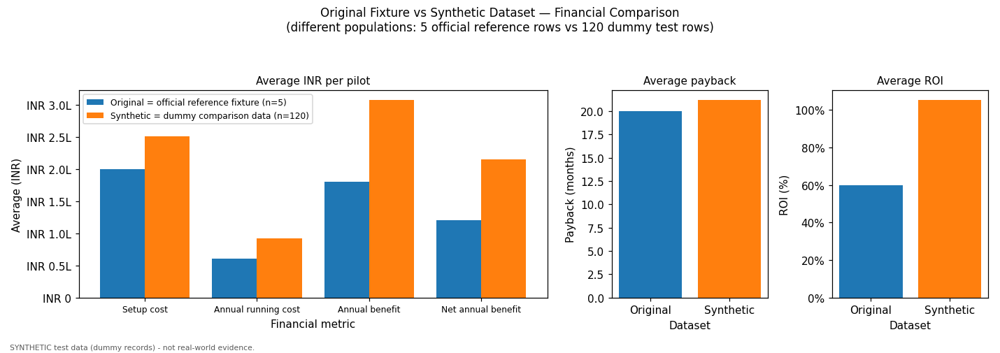
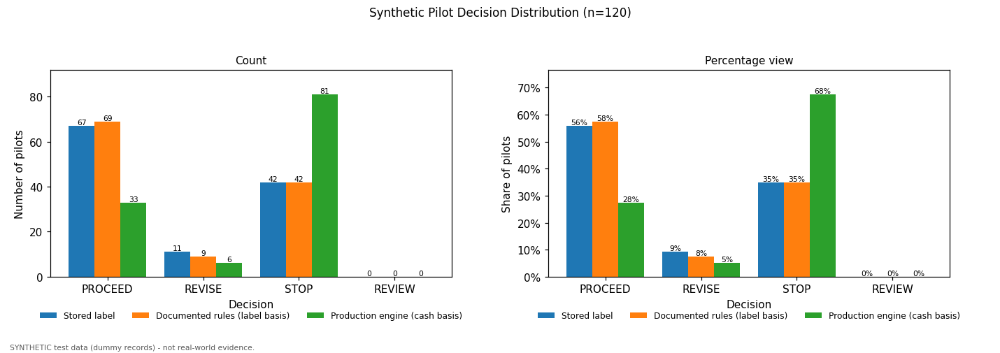
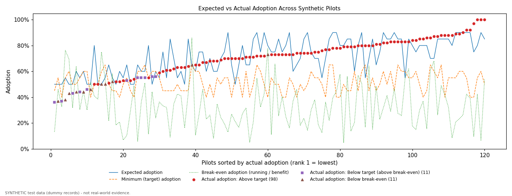
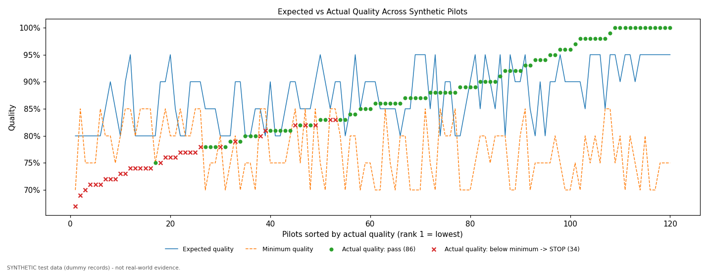
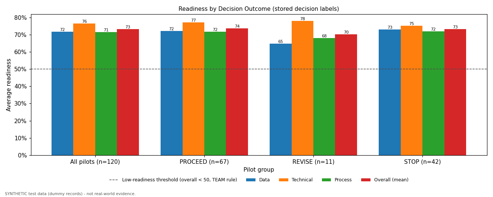
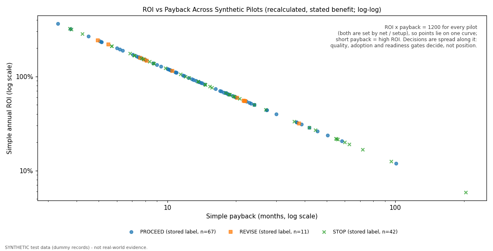
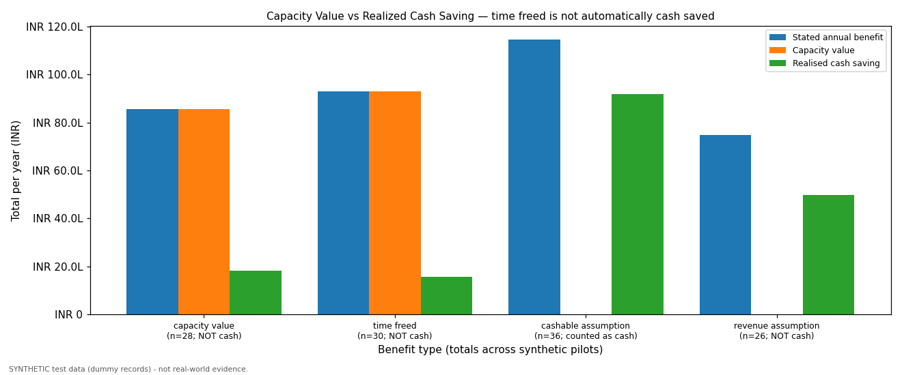
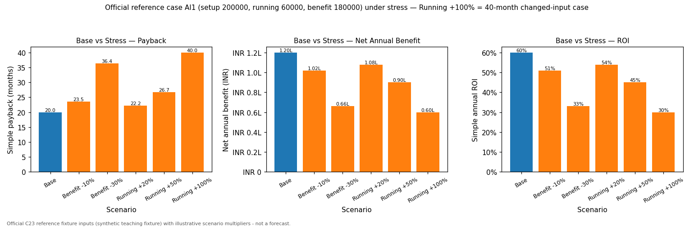
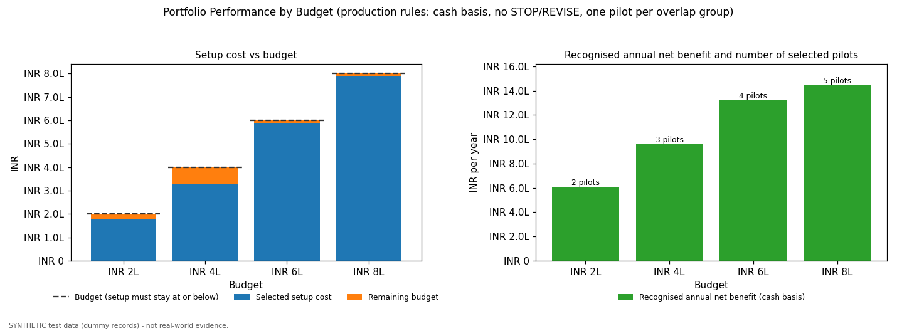
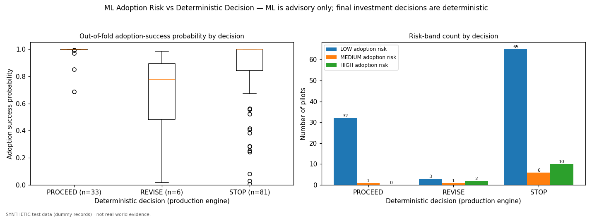

# Synthetic validation charts

Generated by `python -m synthetic.run` (matplotlib, default colour cycle). Every value comes from the official fixture, the
synthetic dataset, exact recalculations, or the advisory model outputs. **All charts except the reference-case stress chart show
SYNTHETIC test data, which is not real-world evidence.**

## Original vs Synthetic Financials

- **File:** `original_vs_synthetic_financials.png` (PASS)
- **Data used:** Original fixture (5 rows) and synthetic CSV (120 rows); net, payback and ROI recalculated from inputs.
- **Shows:** Average setup, running cost, benefit, net benefit, payback and ROI for each dataset.
- **Interpretation:** The synthetic set is costlier and more varied than the five identical fixture rows; on average it pays back in a similar time.
- **Limitation:** Different populations (official reference vs dummy test data); averages are not comparable as market evidence.

## Decision Distribution

- **File:** `decision_distribution.png` (PASS)
- **Data used:** Stored synthetic labels; decisions recalculated with the documented rules on the label basis and by the production engine (cash basis).
- **Shows:** PROCEED / REVISE / STOP / REVIEW counts and shares for the three decision sources.
- **Interpretation:** The production engine is stricter than the labels because non-cash benefit is not counted as cash.
- **Limitation:** Synthetic labels come from a generator; the distribution says nothing about real pilot success rates.

## Adoption Comparison

- **File:** `adoption_comparison.png` (PASS)
- **Data used:** Synthetic expected / actual / minimum adoption; break-even adoption recalculated (running / benefit x 100).
- **Shows:** All 120 pilots sorted by actual adoption, with each pilot's actual value marked by state.
- **Interpretation:** Pilots below break-even lose money at their adoption (STOP); below target but above break-even need revising (REVISE).
- **Limitation:** Dummy adoption values; no real usage data.

## Quality Comparison

- **File:** `quality_comparison.png` (PASS)
- **Data used:** Synthetic expected / actual / minimum quality.
- **Shows:** All 120 pilots sorted by actual quality; failures (actual < minimum) marked with x.
- **Interpretation:** Every quality failure is a STOP regardless of the financial case.
- **Limitation:** Dummy quality values; no real evaluation data.

## Readiness Comparison

- **File:** `readiness_comparison.png` (PASS)
- **Data used:** Synthetic data / technical / process readiness; overall = mean of the three (recalculated).
- **Shows:** Average readiness for all pilots and per stored decision, with the 50% low-readiness threshold.
- **Interpretation:** Readiness barely separates the classes in this dataset; low readiness means fix readiness first, not a failed idea.
- **Limitation:** The 50% threshold is a TEAM assumption; synthetic values only.

## ROI vs Payback

- **File:** `roi_vs_payback.png` (PASS)
- **Data used:** Synthetic inputs; ROI and payback recalculated on the stated benefit; colour = stored decision.
- **Shows:** Relationship between payback duration and simple annual ROI, one point per pilot.
- **Interpretation:** ROI x payback = 1200 exactly for every pilot (ROI = 100 x net / setup, payback = 12 x setup / net), so all points lie on one curve: shorter payback always means higher ROI. Stored decisions are spread along the curve because quality, adoption and readiness gates decide, not finance alone.
- **Limitation:** Synthetic test data only. This is not real market performance evidence.

## Cash vs Capacity

- **File:** `cash_vs_capacity.png` (PASS)
- **Data used:** Synthetic annual_benefit_inr, capacity_value_inr and realized_cash_saving_inr, totalled by benefit type.
- **Shows:** Stated benefit vs capacity value vs realised cash saving for each benefit type.
- **Interpretation:** For time freed and capacity value only a fraction is realised as cash; the engine counts only that fraction.
- **Limitation:** Totals of dummy values; the realised share is generator output, not observed savings.

## Stress Test Comparison

- **File:** `stress_test_comparison.png` (PASS)
- **Data used:** Official fixture AI1 inputs with the benefit / running-cost multipliers applied (recalculated exactly).
- **Shows:** Payback, net annual benefit and ROI for the base case and five stress scenarios.
- **Interpretation:** Doubling the running cost halves the net benefit and doubles payback to 40 months (the official changed-input check).
- **Limitation:** Single reference pilot; multipliers are illustrative scenarios, not forecasts.

## Portfolio Budget Comparison

- **File:** `portfolio_budget_comparison.png` (PASS)
- **Data used:** Exact optimizer results on the 120 synthetic pilots (production rules, cash basis) for INR 2L / 4L / 6L / 8L.
- **Shows:** Selected setup vs remaining budget, recognised annual net benefit and number of pilots per budget.
- **Interpretation:** Setup never exceeds the budget; net benefit rises with budget with diminishing additions.
- **Limitation:** Portfolio of dummy pilots; benefits are assumptions.

## ML vs Rules

- **File:** `ml_vs_rule_comparison.png` (PASS)
- **Data used:** Out-of-fold probabilities from the advisory adoption-success model; production engine decisions.
- **Shows:** Probability distribution and risk-band counts per deterministic decision.
- **Interpretation:** Highlights pilots whose adoption may need validation; the rule decision never changes.
- **Limitation:** ML is advisory only and trained/evaluated on synthetic data; final investment decisions are deterministic.
